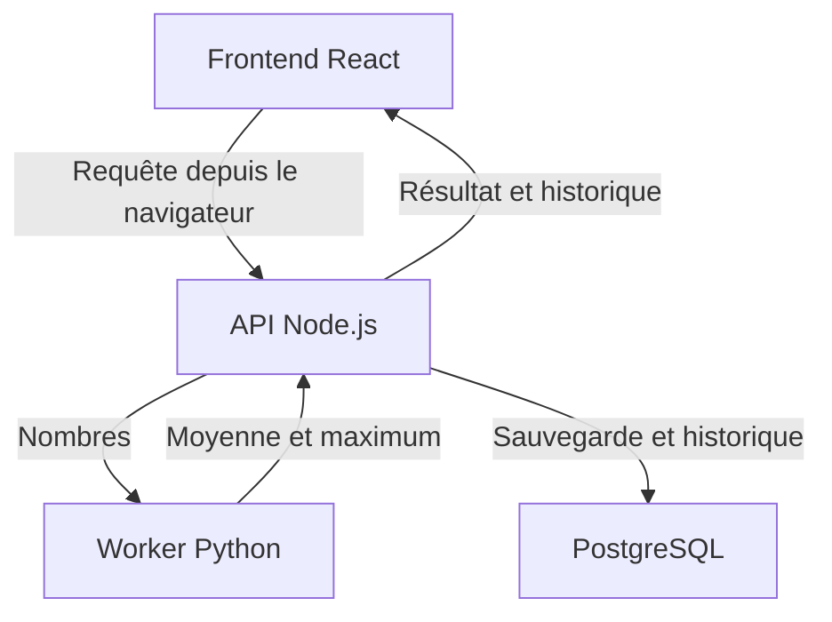
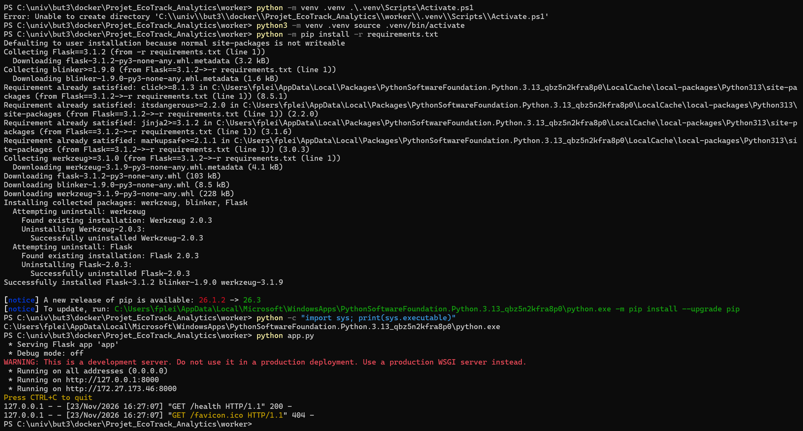
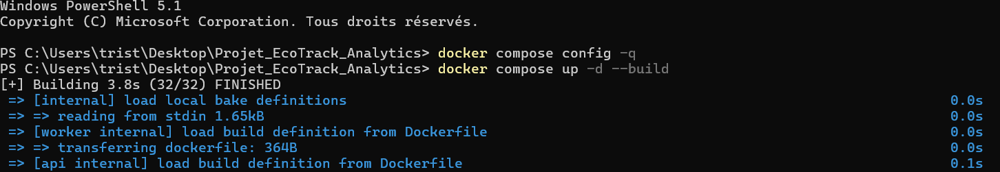
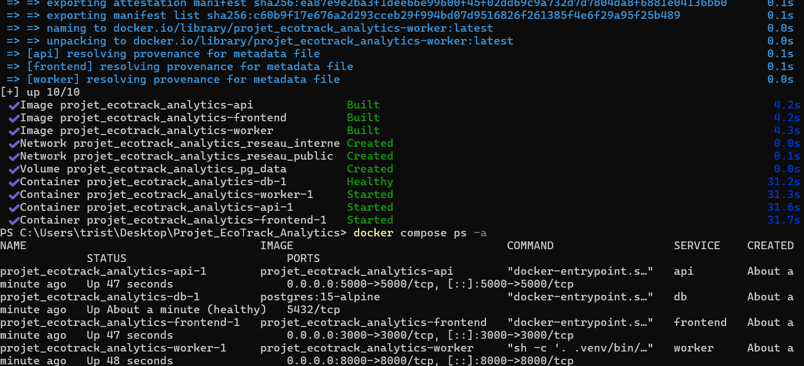
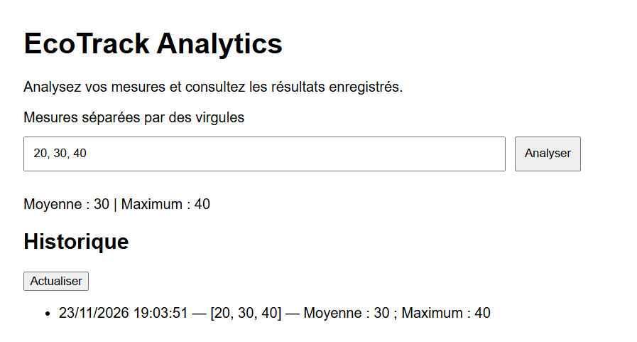
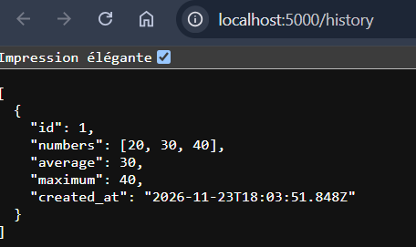
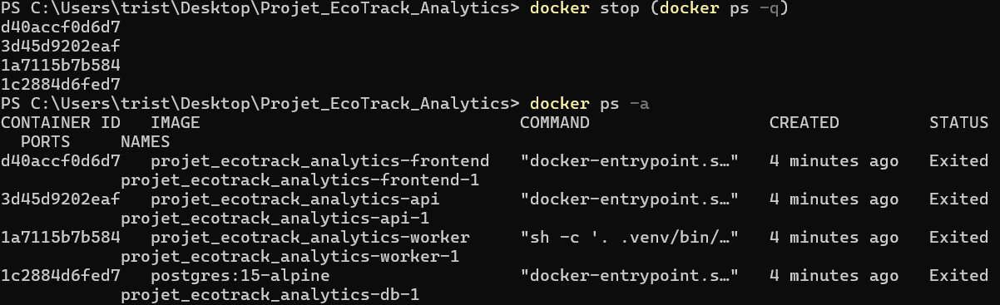

# EcoTrack Analytics

Une organisation souhaite analyser des séries de mesures et conserver les résultats. Depuis une page React, l’utilisateur lance un calcul. L’API Node.js demande au service Python de calculer la moyenne et le maximum, puis enregistre le résultat dans PostgreSQL. La page affiche le résultat et l’historique.



Le JavaScript React s’exécute dans le navigateur. Le conteneur frontend sert les fichiers de la page. Le navigateur appelle localhost:5000 ; dans Docker, l’API contacte worker et db par leur nom de service.

## Votre mission

### 1. Identifier les services

| Dossier ou service | Technologie | Commande de lancement | Port |
|---|---|---|---|
| frontend | React et serveur Node.js | npm run build puis npm start | 3000 |
| api | Node.js Express | npm start | 5000 |
| worker | Python Flask | python app.py | 8000 |
| db | Image postgres:15-alpine | À configurer dans Compose | 5432 interne |


### 2. Tester Python avec un venv

Windows PowerShell :

```powershell
py -m venv .venv
.\.venv\Scripts\Activate.ps1
```

Linux ou macOS :

```bash
python3 -m venv .venv
source .venv/bin/activate
```

Puis :

```bash
python -m pip install -r requirements.txt
python -c "import sys; print(sys.executable)"
python app.py
```

Le chemin Python doit contenir .venv. Ouvrir http://localhost:8000/health : résultat attendu {"status":"ok"}.


### 3. Créer les images

### 4. Configurer Compose

### 5. Ajouter le secret

### 6. Lancer et vérifier

À la racine, après création des fichiers Docker :

```bash
docker compose config -q
docker compose up -d --build
docker compose ps -a
```

Ouvrir http://localhost:3000 pour l’interface et http://localhost:5000/status pour vérifier les trois services backend.


Si nécessaire :

```bash
docker compose logs api
docker compose logs worker
docker compose logs db
docker compose logs frontend
```

### 7. Compléter le dépôt et remettre

Inclure le code fourni, les trois Dockerfiles, les .dockerignore, compose.yaml, requirements.txt, .gitignore et ce README complété.

Ajouter ici :

- Les noms du binôme et le groupe.

    - Tristan Fabre A2
    - Florian Pleigneur A2
      
- Vos commandes de lancement et d’arrêt.

Après avoir cloné le projet, il est nécessaire de recréer votre secret. Pour cela, créer un fichier nommé "db_password.txt" à la racine du projet, puis insérez votre mot de passe à l'intérieur.

Ensuite, vous devez entrez la commande suivante dans votre terminal : "docker compose up -d --build"

Pour arrêter les services, vous devrez faire la commande suivante : "docker compose down -v"


- Vos preuves : commande ou action, résultat observé et explication.

python :



Le test de création d'un environnement virtuel en python fonctionne donc comme attendu.




Il est donc possible d'observer que les différents conteneurs ainsi que les services qu'ils regroupent démarrent correctement à la suite des commandes.

- Les vérifications du calcul, de la persistance, des réseaux et du secret.

Après avoir lancé un calcul depuis l'interface frontend, l'historique se met bien à jour du côté du frontend ainsi que de l'api.
Les résultats sont également correct, comme vous pouvez le constater sur les captures suivantes. 




Pour tester la persistance des données, nous arrêtons les conteneurs en cours, puis les relançons.



En retournant sur l'historique de l'api, les données des anciens calculs sont bien toujours présentes !


Exclure db_password.txt, .env, .venv et node_modules. Après un nouveau clonage, un lecteur doit pouvoir recréer le secret et démarrer l’application.

Déposer le lien du dépôt GitLab dans le devoir Moodle avant l’échéance annoncée. Donner accès à l’enseignante.

### Endpoints fournis

| Service | Méthode et chemin | Rôle |
|---|---|---|
| worker | GET /health | Vérifier Python |
| worker | POST /analyze | Recevoir {"numbers":[10,20,30]} et calculer |
| api | GET /health | Vérifier le processus Node.js |
| api | GET /status | Vérifier PostgreSQL et worker |
| api | POST /analyze | Calculer via Python et enregistrer |
| api | GET /history | Lire les 50 derniers résultats |
